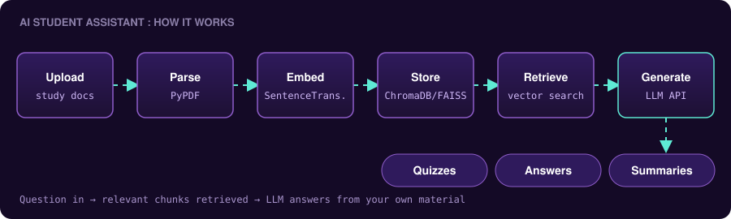

## 👋 About me

I'm an **AI/ML-focused Software Developer** who enjoys building practical Generative AI applications in **Python**. I work with **LLM APIs, embeddings, vector search and RAG** to turn plain documents into something you can actually talk to.

My main project is an **AI Student Assistant** that answers questions, summarizes study material and generates quizzes from uploaded documents. I built it end to end, and sharpened that experience during my **AI internship at Orvionar Private Ltd, Bangalore**.

- 🔭 Currently working on: Generative AI and RAG-based applications
- 🌱 Exploring: better retrieval, evaluation of LLM answers, and shipping AI apps
- 📍 Based in Kanyakumari, Tamil Nadu, India
- 📫 Reach me: [sherginsnshergin@gmail.com](mailto:sherginsnshergin@gmail.com)

## 🧰 Tech stack

## 🚀 Featured project

### 🎓 AI Student Assistant using Python and Generative AI

`Python` `Streamlit` `LLM APIs` `RAG` `Embeddings` `ChromaDB` `FAISS` `SentenceTransformers` `PyPDF`

An AI-powered chatbot that answers academic questions from the study materials you upload. Instead of guessing, it retrieves the most relevant parts of your documents and gives them to an LLM, so answers stay grounded in your own notes.

**What it does**
- 💬 Answers questions from uploaded documents
- 📝 Summarizes study materials
- 🧠 Generates quizzes for revision

> 🔗 Repo: _add the link to your repository here_

## 💼 Experience

**AI Intern · Orvionar Private Ltd, Bangalore** &nbsp;|&nbsp; _Jun 2026 - Sep 2026_

- Worked on AI/ML-based applications and built practical experience in AI concepts and development
- Developed and implemented AI-based solutions using Python and machine learning technologies
- Handled data processing, model integration, testing and debugging to improve application functionality
- Collaborated with the development team to understand requirements and deliver working AI applications

## 🎓 Education

**B.E. Computer Science and Engineering** · 2022 - 2026 · CGPA: 7.82
Good Shepherd College of Engineering & Technology, Maruthamparai (Affiliated to Anna University)

## 🗺️ Journey

## 📊 GitHub stats

## 🤝 Let's connect

I'm open to **AI / ML and software developer roles**. If you're building something with LLMs, RAG or Python, I'd love to hear about it.

